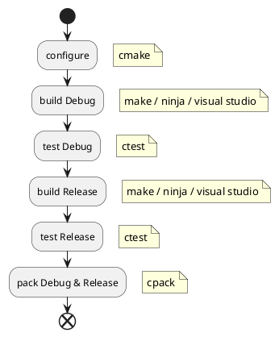
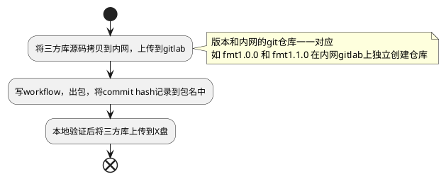
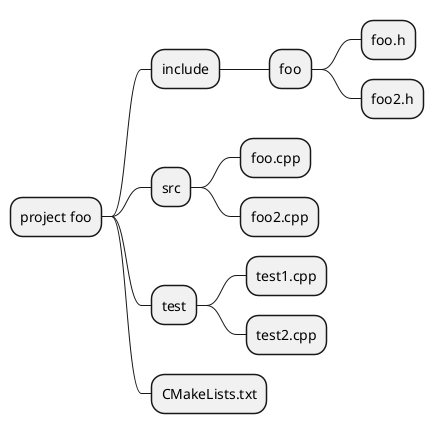
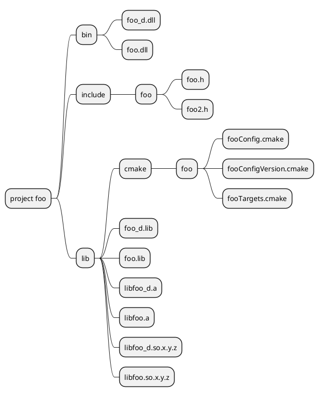

# CMake 使用备忘录

## 整体流程: CMake Preset + Workflow



## 三方库（有源码）

问题：
即使只有一份源代码，下游对三方库的需求也不尽相同（比如OpenMP开启与否，不同下游采用不同的blas实现……），导致相同的三方库会出现不同的发行版。

解决方案：
commit hash是唯一的，将其写到包名中，即可完成溯源。



优势：
1. 三方库编译过程记录在workflow中，高度自动化
2. 可以通过包名的commit hash溯源到编译配置

## 三方库（无源码）

### 有源码，但是制品无法溯源的三方库 - “既往不咎”
1. 手写`*Config.cmake`，提供`find_package`支持
2. 如果更新三方库版本，则按照 **三方库（有源码）** 的做法重新编译、上传三方库

### 没有源码的三方库：Intel MKL
- 已经和utcc整合并且一起发布

## Modern CMake

### 项目结构


### 基于`target`
- `target_sources`：添加源文件
- `target_sources + FILE_SET`：简化头文件的安装
- ❌ 不要使用`file(GLOB ...)`
- ⚠ 注意`PUBLIC/PRIVATE/INTERFACE`的区别
- `target_include_directories + BUILD_INTERFACE + INSTALL_INTERFACE`：控制构建和安装两种情况下的包含目录
- `target_link_libraries`
- ✔ 库名添加双冒号`namespace`防呆
- `target_compile_definitons`
- `target_compile_options`


### `GNUInstallDirs`


### 安装

头文件的存在，以及缺乏统一的包管理模式，导致 CMake 的安装过程并不智能，需要程序员构思最终的包布局，并且对产品负责。

- `install(TARGETS ... DESTINATION ... EXPORT ... FILE_SET ...)`
安装target的二进制文件，指定EXPORT名称，如果target使用了`FILE_SET`，也可以安装它（比如头文件）

- `install(EXPORT ... DESTINATION ... NAMESPACE ...)`
安装导出文件`fooTargets.cmake`

- `configure_package_config_file`
配置、生成“配置文件”`fooConfig.cmake`，其中可以检查依赖（`find_dependency`），并且向下游提供一些路径（如`FOO_INCLUDE_DIR`）。下游通过设置`foo_DIR`变量到`fo`

- `write_basic_config_version_file`
生成版本文件`fooConfigVersion.cmake`，通过语义化的版本号约束下游的依赖

- `install(FILES ... DESTINATION ...)`
安装文件。需要将生成于`CMAKE_CURRENT_BINARY_DIR`中的`fooConfig.cmake`和`fooConfigVersion.cmake`安装到`lib/cmake/foo`下面。

- `install(DIRECTORY ... DESTINATION ...)`
安装整个目录，适合安装文档。

### 整合 CTest 和 GoogleTest
```cmake
include(CTest)
include(GoogleTest)
enable_testing()

# ...

add_executable(foo_test foo_test.cpp)
target_link_libraries(foo_test PRIVATE GTest::gtest foo::foo)
gtest_discover_tests(foo_test)
```

## 其他话题

1. 拷贝windows动态库
```cmake
add_custom_command(TARGET exe POST_BUILD
  COMMAND ${CMAKE_COMMAND} -E copy -t $<TARGET_FILE_DIR:exe> $<TARGET_RUNTIME_DLLS:exe>
  COMMAND_EXPAND_LISTS
)
```

2. `RelWithDebInfo`的客户端错误链接上游的`Debug`库
```cmake
# 客户端代码
set_target_properties(foo::foo PROPERTIES
    MAP_IMPORTED_CONFIG_RELWITHDEBINFO RELEASE
)
```

3. EXPORT宏
```cmake
include(GenerateExportHeader)
generate_export_header(foo ...)
```

头文件会生成在`CMAKE_CURRENT_BINARY_DIR`下，target需要包含对应的目录，将export文件添加到FILE_SET，通过安装命令发布该文件。